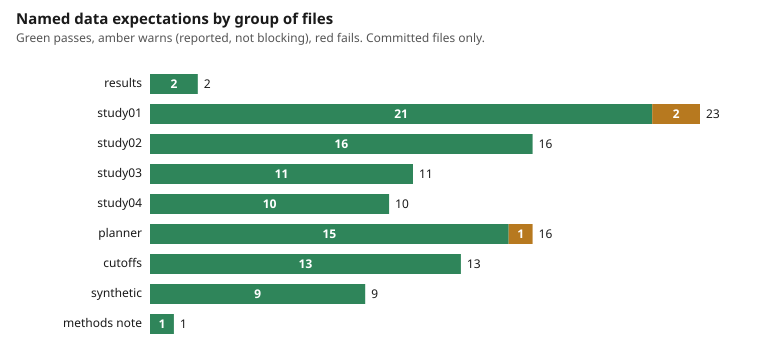
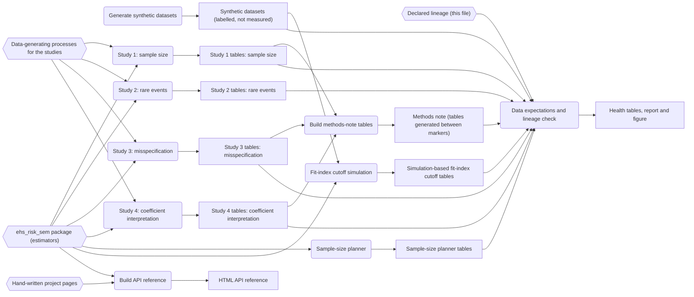

# Data health and pipeline lineage

Generated by `python3 tools/health.py --write`; do not edit by hand. `tests/test_health.py` fails if this file, `docs/health.svg` or `health/*.csv` differ from the generator output.

A Foundry-style practice in plain Python on committed files: every rule below is a named expectation with an observed value, a limit and a status, and the build pipeline is declared as stages with inputs and outputs and checked against the repository. Independent of and not affiliated with Palantir. Every table checked here comes from a simulation with a known generating model; none is a measurement of real workplaces.

## Result

101 expectations: 98 pass, 3 warn, 0 fail. Rows: `health/health_checks.csv`. Empty-cell profile of every column of every results table: `health/health_columns.csv`.



| Group | Expectations | Pass | Warn | Fail |
|---|---|---|---|---|
| results | 2 | 2 | 0 | 0 |
| study01 | 23 | 21 | 2 | 0 |
| study02 | 16 | 16 | 0 | 0 |
| study03 | 11 | 11 | 0 | 0 |
| study04 | 10 | 10 | 0 | 0 |
| planner | 16 | 15 | 1 | 0 |
| cutoffs | 13 | 13 | 0 | 0 |
| synthetic | 9 | 9 | 0 | 0 |
| methods note | 1 | 1 | 0 | 0 |

## What the warnings say

- R25 `study01`: analytic SE is not below 90% of the empirical SD in any row (lowest ratio shown). Observed 0.631, limit >= 0.9 for all.
- R26 `study01`: analytic 95% coverage is at least 0.93 in every row. Observed 0.757, limit 0.93.
- R80 `planner`: weak-loading planner run has at least 95% proper solutions at every N. Observed 0.743, limit 0.95.

Warnings are the repository's own findings restated as data limits: they describe results the methods note and the planner already reports (the analytic standard errors understate the sampling spread, and a weak-loading survey needs a larger N to give a proper solution). They are reported so a reader sees the limit and they do not block CI. A new error-severity failure does.

## What this does and does not show

- The expectations check that each committed table has its declared columns, plausible values, and the identities that must hold inside and between files (for example PPV recomputed from Bayes' rule, bias equal to estimate minus truth, the same true betas in four files). They do not re-run the simulations or check that a simulation is correct: that is the estimator-recovery tests.
- Tolerances and the 0.93 coverage and 0.95 proper-solution thresholds are judgement, set from conventional targets.
- The lineage is declared, then validated (paths, functions via ast, undeclared outputs, double producers, cycles); it is not discovered by tracing execution.

## Pipeline lineage

10 stages, 14 artifacts. Hexagons are hand-written sources, rectangles are committed generated files.



| # | Stage | Command | Reads | Writes |
|---|---|---|---|---|
| 1 | Generate synthetic datasets | `python3 synthetic/generate_synthetic_datasets.py` | none | Synthetic datasets (labelled, not measured) |
| 2 | Study 1: sample size | `python3 simulations/run_all.py` | ehs_risk_sem package (estimators), Data-generating processes for the studies | Study 1 tables: sample size |
| 3 | Study 2: rare events | `python3 simulations/run_all.py` | ehs_risk_sem package (estimators), Data-generating processes for the studies | Study 2 tables: rare events |
| 4 | Study 3: misspecification | `python3 simulations/run_all.py` | ehs_risk_sem package (estimators), Data-generating processes for the studies | Study 3 tables: misspecification |
| 5 | Study 4: coefficient interpretation | `python3 simulations/run_all.py` | ehs_risk_sem package (estimators), Data-generating processes for the studies | Study 4 tables: coefficient interpretation |
| 6 | Sample-size planner | `python3 tools/sample_size_planner.py --loading 0.75 --out results/planner_loading075.csv` | ehs_risk_sem package (estimators) | Sample-size planner tables |
| 7 | Fit-index cutoff simulation | `python3 tools/fit_index_cutoffs.py --reps 500 --out results/fit_index_cutoffs_n1200.csv` | ehs_risk_sem package (estimators), Synthetic datasets (labelled, not measured) | Simulation-based fit-index cutoff tables |
| 8 | Build methods-note tables | `python3 tools/methods_note_tables.py` | Study 1 tables: sample size, Study 3 tables: misspecification, Study 4 tables: coefficient interpretation | Methods note (tables generated between markers) |
| 9 | Build API reference | `python3 tools/build_api_docs.py` | ehs_risk_sem package (estimators), Hand-written project pages | HTML API reference |
| 10 | Data expectations and lineage check | `python3 tools/health.py --write` | Synthetic datasets (labelled, not measured), Study 1 tables: sample size, Study 2 tables: rare events, Study 3 tables: misspecification, Study 4 tables: coefficient interpretation, Sample-size planner tables, Simulation-based fit-index cutoff tables, Methods note (tables generated between markers), Declared lineage (this file) | Health tables, report and figure |

## Reproduce

```
python3 tools/health.py --write
python3 tools/health.py --check
```
